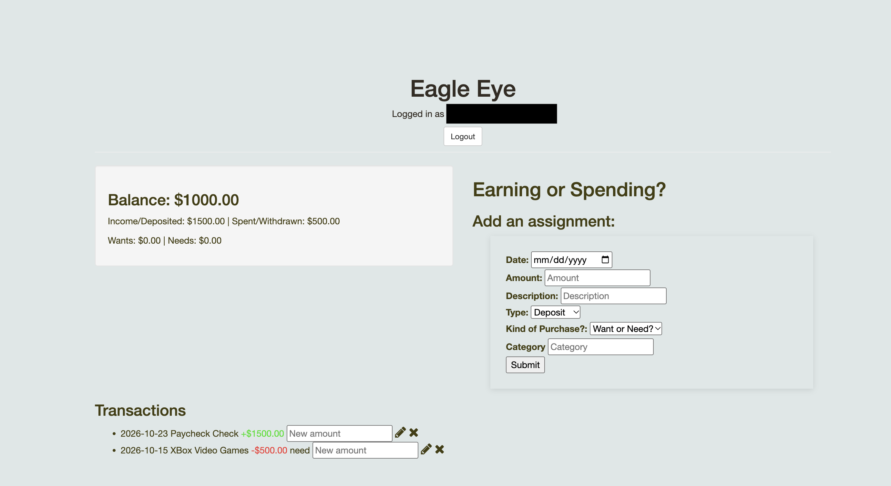

# Eagle Eye

Your first bank account.

Eagle Eye is a beginner-friendly money tracker. You sign up, log your deposits and purchases, and watch your balance update. Each purchase is tagged as a **want** or a **need**, so you can see where your money is actually going.

**Live demo:** https://eagle-eye-9z89.onrender.com



## What it does

- **User accounts** — sign up and log in with email and password. Passwords are hashed with bcrypt, and sessions are handled by Passport.
- **Private ledger** — every transaction belongs to the logged-in user, so you only ever see your own.
- **Log transactions** — record the date, amount, description, and category, and choose **Deposit** or **Purchase**, plus a want/need tag.
- **Live summary** — see your current balance (deposits minus purchases), total deposited, total spent, and your wants and needs totals.
- **Edit amounts** — type a new amount next to a transaction and click the pencil. Editing changes the amount only, not the description, date, or type.
- **Delete transactions** — click the ✖ to remove one.
- **Color-coded history** — deposits show in green (+), purchases in red (−), newest first.

## Tech stack

- Node.js + Express 4
- EJS templates + Bootstrap 3
- MongoDB (Atlas) — Mongoose for users, native driver for transactions
- Passport (local strategy), bcrypt-nodejs, express-session, connect-flash
- Vanilla JavaScript (Fetch API), Font Awesome

## Getting started

1. Clone the repo and install dependencies:

   ```bash
   git clone https://github.com/tbrown320/eagle-eye.git
   cd eagle-eye
   npm install
   ```

2. Create a `.env` file in the project root with your MongoDB connection string and a session secret:

   ```
   MONGO_URI=your-mongodb-connection-string
   SESSION_SECRET=your-session-secret
   ```

   `config/database.js` reads `MONGO_URI` from the environment and uses the database name `starter-account`. The `users` and `transactions` collections are created automatically the first time you use the app. `.env` is gitignored — never commit it.

3. Start the server:

   ```bash
   node server.js
   ```

4. Open http://localhost:8085 in your browser. To use a different port, set the `PORT` environment variable.

## Project structure

```
server.js              - app entry point (port 8085, or $PORT)
Procfile               - web: node server.js (for deployment)
app/
  routes.js            - routes: home, dashboard, add/edit/delete transactions, auth
  models/user.js       - user model
config/
  database.js          - database connection (MONGO_URI, db name: starter-account)
  passport.js          - local signup / local login setup
views/
  index.ejs            - landing page
  login.ejs            - login form
  signup.ejs           - signup form
  profile.ejs          - balance summary + add-a-transaction form + transactions
  connect-local.ejs    - connect a local account
public/
  main.js              - edit and delete transactions (Fetch: PUT /transactions, DELETE /transactions)
  style.css            - layout and styling
  img/savage21.jpg     - unused image (see Roadmap)
```

---

Thay Brown — thaybrown22@gmail.com · https://thaythecoder.netlify.app · https://github.com/tbrown320 · https://www.linkedin.com/in/thaybrown
