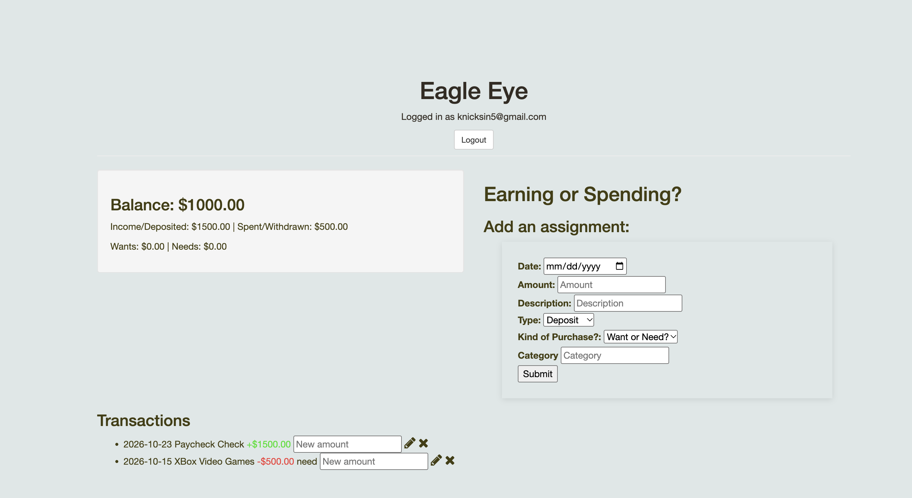

# Eagle Eye

**Your first bank account.** Eagle Eye is a beginner-friendly money tracker. You sign up, log your deposits and purchases, and watch your balance update. Each purchase is tagged as a **want** or a **need**, so you can see where your money is actually going.



## Features

- **User accounts:** sign up and log in with email and password. Passwords are hashed with bcrypt, and sessions are handled by Passport.
- **Private ledger:** every transaction belongs to the logged-in user, so you only ever see your own.
- **Log transactions:** record the date, amount, description, and category, and choose **Deposit** or **Purchase**.
- **Wants vs. needs:** tag each purchase as a want or a need to build better spending habits.
- **Live summary:** see your current balance, total deposited, total spent, and your wants and needs totals.
- **Edit amounts:** type a new amount next to a transaction and click the ✏️ pencil.
- **Delete transactions:** click the ✖ to remove one.
- **Color-coded history:** deposits show in green (+), purchases in red (−), newest first.

## Tech Stack

- **Backend:** Node.js, Express
- **Database:** MongoDB (Atlas), with Mongoose for users and the native driver for transactions
- **Auth:** Passport.js (local strategy), bcrypt-nodejs, express-session, connect-flash
- **Templating:** EJS
- **Frontend:** vanilla JavaScript (Fetch API), Bootstrap 3, Font Awesome

## Getting Started

### Prerequisites

- [Node.js](https://nodejs.org/) and npm
- A MongoDB database, either a free [MongoDB Atlas](https://www.mongodb.com/atlas) cluster or a local MongoDB install

### Installation

1. Clone the repo:
   ```bash
   git clone <your-repo-url>
   cd eagle-eye
   ```
2. Install dependencies:
   ```bash
   npm install
   ```
3. Create a `.env` file in the project folder with your MongoDB connection string and a session secret:
   ```
   MONGO_URI=your-mongodb-connection-string
   SESSION_SECRET=any-long-random-string
   ```
   The `users` and `transactions` collections are created automatically the first time you use the app.

### Running the app

```bash
node server.js
```

Then open **http://localhost:8085** in your browser. To use a different port, set the `PORT` environment variable.
